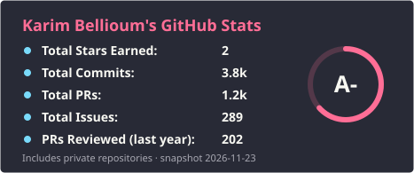

### Hi, I'm Karim 👋

Engineer building internal platforms, operational tooling and AI agents in fintech.

- 🔧 Internal hubs and back-office workflows (onboarding, compliance, operations)
- 🤖 AI agents for support investigation, with evaluation and tracing
- 🗄️ Lots of SQL Server and PostgreSQL, running on Kubernetes

**Stack:** Python · Django · Svelte · TypeScript · LangGraph · Langfuse · SQL Server · PostgreSQL · Kubernetes

Most of my work lives in private repositories; what's here is older public experiments.

  
  

